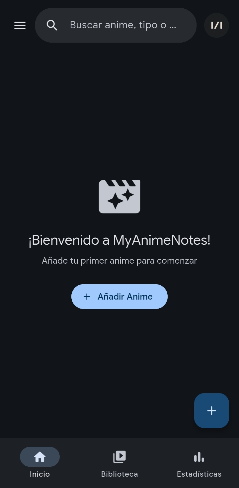
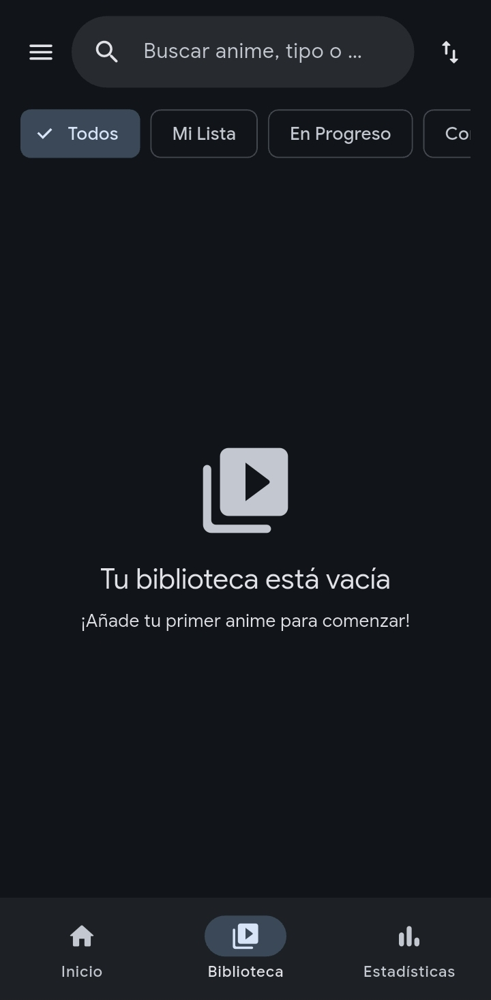
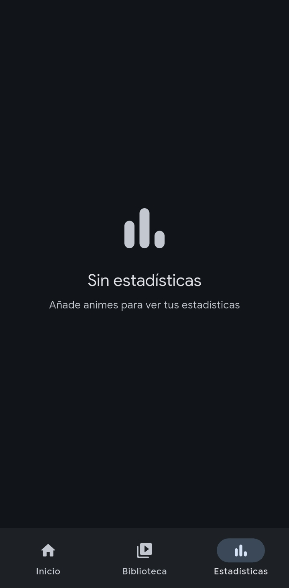

# MyAnimeNotes

Aplicación para Android que te permite llevar el registro de los animes que estás viendo, los que ya completaste y los que tienes pendientes.

## Capturas de pantalla

  
  
  

## Características

- **Biblioteca personal**: Organiza tus animes por estado (viendo, completado, pendiente, abandonado)
- **Seguimiento de progreso**: Registra la temporada y episodio actual de cada anime
- **Estadísticas**: Visualiza resúmenes de tu actividad y preferencias
- **Destacados**: Marca tus animes favoritos para acceso rápido
- **Sincronización en la nube**: Respalda y restaura tu biblioteca con Google Drive
- **Temas personalizables**: Modo claro, oscuro y automático según el sistema
- **Estilos de color**: Elige entre Azul, Monocromático o Neutral

## Requisitos

- Android 8.0 (API 26) o superior

## Instalación

Descarga el APK desde la sección de [Releases](../../releases) e instálalo en tu dispositivo Android.

## Tecnologías

- Flutter 3.x
- Dart
- Material 3 Expressive
- Google Sign-In
- Google Drive API

## Licencia

Copyright © 2026 dony-aep. Todos los derechos reservados. Consulta el archivo [LICENSE](LICENSE) para más detalles.
