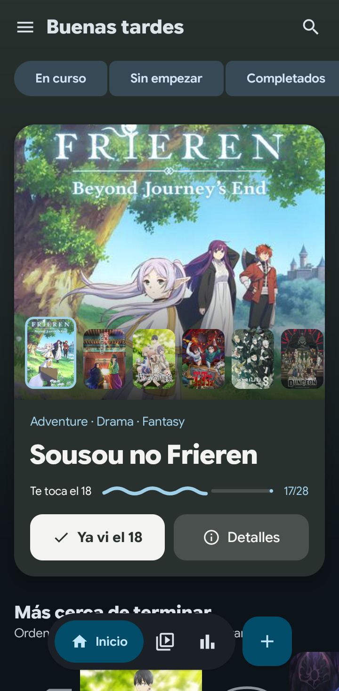
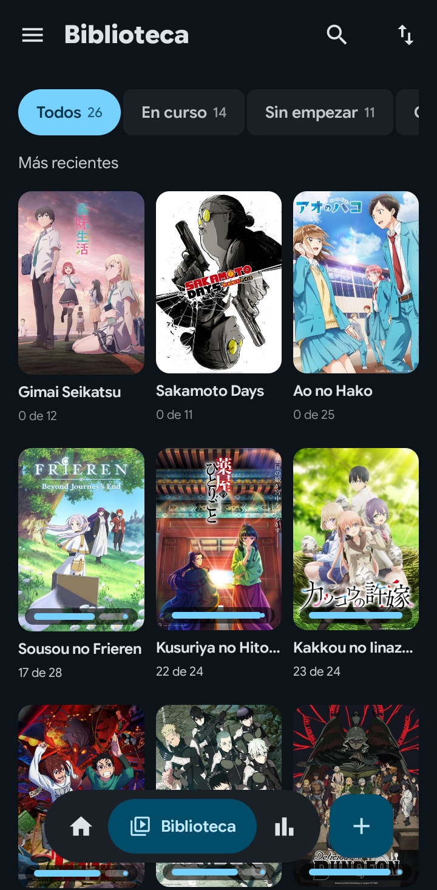
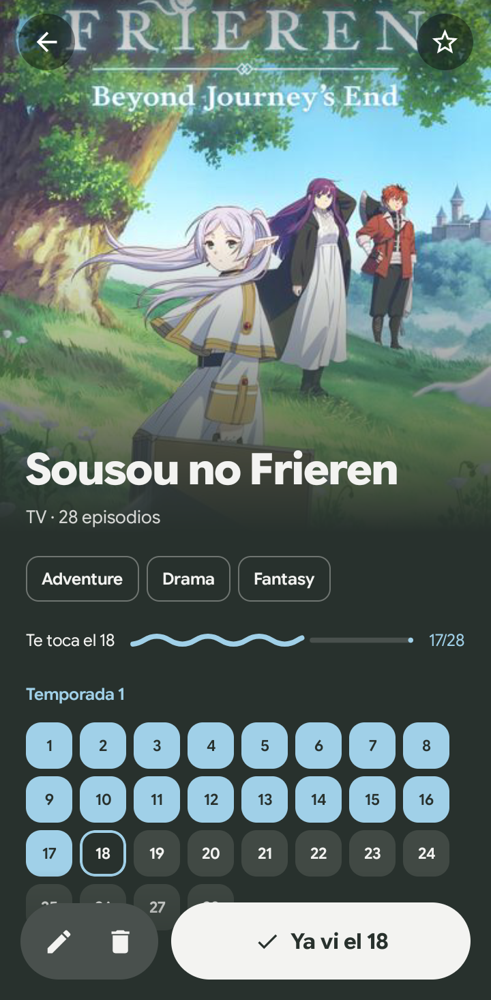
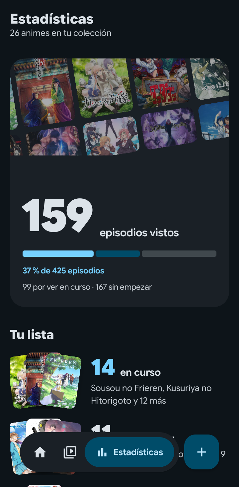
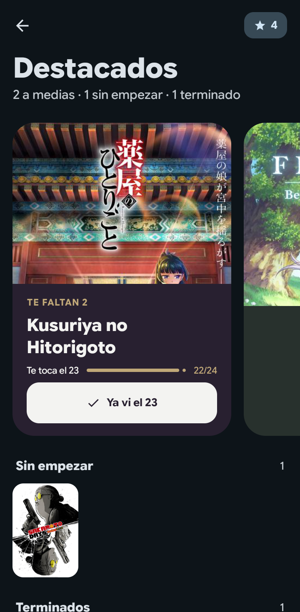
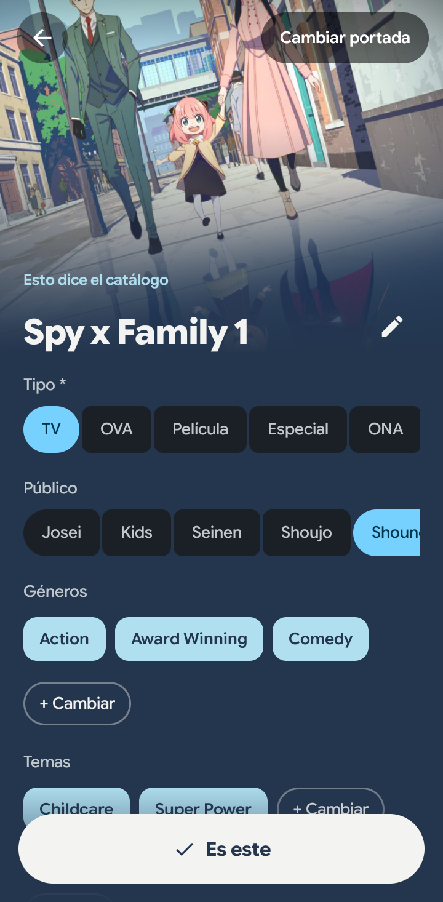

# MyAnimeNotes

Aplicación para Android que te permite llevar el registro de los animes que estás viendo, los que ya completaste y los que tienes pendientes.

## Capturas de pantalla

  
  
  

| Inicio | Biblioteca | Ficha de un anime |
|:------:|:----------:|:-----------------:|
| Qué seguir viendo y el episodio que te toca | Tus animes en pósters, con su progreso | Los episodios de cada temporada en una rejilla |

  
  
  

| Estadísticas | Destacados | Añadir un anime |
|:------------:|:----------:|:---------------:|
| Episodios vistos y lo que te queda por ver | Los que marcaste con la estrella | La ficha se rellena sola desde el catálogo |

Las capturas usan datos de demostración.

## Características

- **Portada como protagonista**: Inicio propone qué seguir viendo en una tarjeta teñida del color de su portada, y Biblioteca es una cuadrícula de pósters con su progreso
- **Seguimiento de progreso**: Marca el último episodio que viste en la rejilla de cada temporada, o pulsa «Ya vi el…» para dar por visto el que toca
- **Añadir desde el catálogo**: Busca el anime en el catálogo de portadas y se rellenan solos la portada, el tipo, los géneros y los episodios
- **Búsqueda y filtros**: Busca dentro de tu biblioteca, marca varios géneros a la vez y filtra por estado, tipo y demografía
- **Estadísticas**: Cuántos episodios llevas vistos y cuántos te quedan, por estado y por género
- **Destacados**: Marca tus animes con la estrella para tenerlos a mano
- **Copia en Google Drive**: Tu lista se sube sola a Drive, y la misma copia se abre en la [versión web](https://m3myanimenotes.vercel.app/)
- **Temas personalizables**: Modo claro, oscuro y automático según el sistema
- **Importar/Exportar**: Guarda tu lista en un archivo JSON, el mismo formato que usa la web, y júntala con otra al importarla

## Requisitos

- Android 8.0 (API 26) o superior

## Instalación

Descarga el APK desde la sección de [Releases](../../releases) e instálalo en tu dispositivo Android.

## Tecnologías

- Kotlin
- Jetpack Compose
- Material 3 Expressive
- Hilt (Dependency Injection)
- Jetpack DataStore
- Google Credential Manager
- Google Drive API
- Coil (Image Loading)

## Licencia

Copyright © 2026 dony-aep. Todos los derechos reservados. Consulta el archivo [LICENSE](LICENSE) para más detalles.
