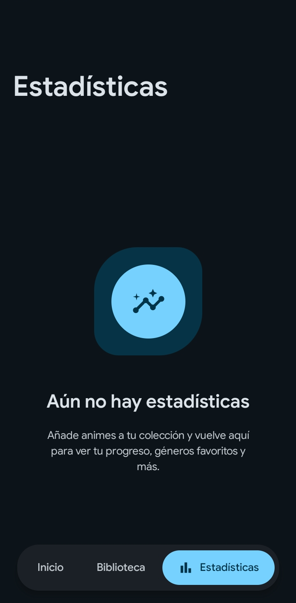

# MyAnimeNotes

Aplicación para Android que te permite llevar el registro de los animes que estás viendo, los que ya completaste y los que tienes pendientes.

## Capturas de pantalla

  
  
  

## Características

- **Biblioteca personal**: Organiza tus animes por estado (viendo, completado, pendiente, favoritos)
- **Seguimiento de progreso**: Registra la temporada y episodio actual de cada anime
- **Avance rápido**: Avanza episodios directamente desde las tarjetas de la biblioteca
- **Estadísticas**: Visualiza resúmenes de tu actividad y preferencias
- **Destacados**: Marca tus animes favoritos para acceso rápido
- **Sincronización en la nube**: Respalda, restaura y elimina backups con Google Drive
- **Temas personalizables**: Modo claro, oscuro y automático según el sistema
- **Filtros avanzados**: Filtra por tipo, demografía y ordena por progreso, título o fecha
- **Importar/Exportar**: Importa y exporta tu lista en formato JSON

## Requisitos

- Android 8.0 (API 26) o superior

## Instalación

Descarga el APK desde la sección de [Releases](../../releases) e instálalo en tu dispositivo Android.

## Tecnologías

- Kotlin
- Jetpack Compose
- Material 3 Expressive
- Hilt (Dependency Injection)
- Jetpack DataStore
- Google Credential Manager
- Google Drive API
- Coil (Image Loading)

## Licencia

Copyright © 2026 dony-aep. Todos los derechos reservados. Consulta el archivo [LICENSE](LICENSE) para más detalles.
